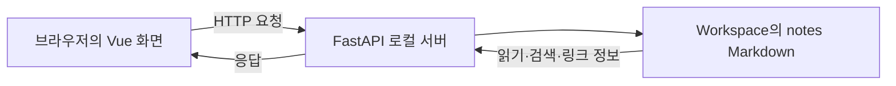
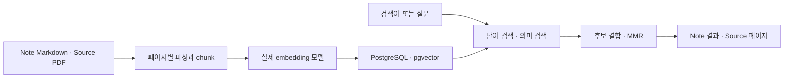
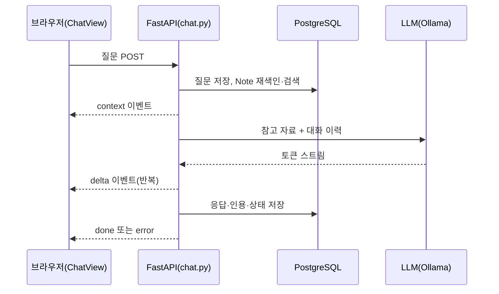
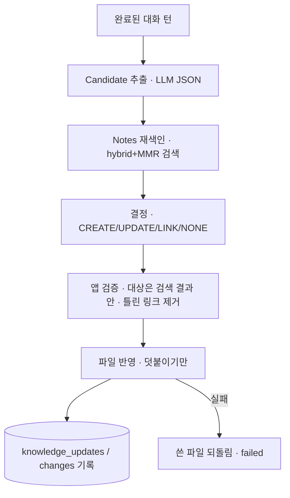
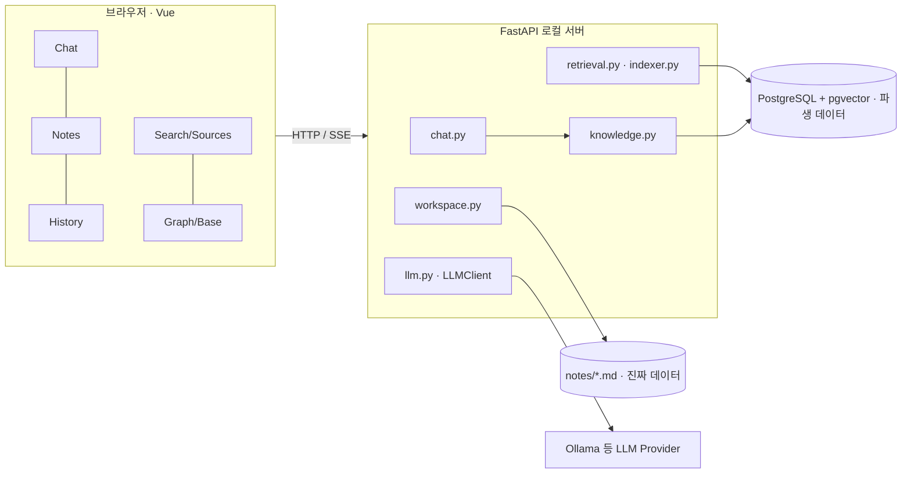

# 지식 팔레트 작업 내역

## 이번 작업의 기준

- 시작: 2026-10-06 23:29 KST. 마감: 2026-10-07 07:00 KST.
- 현재 상태: 아래 "2026-10-13 재개 세션"에서 이어서 진행한다. 이 절(첫 세션 기준)의 시간 제한과 opencode 규칙은 첫 세션에만 적용된다.
- 기획: `docs/knowledge-palette-plan.md`, 범위/순서: `docs/knowledge-palette-mvp-scope.md`, 구조: `docs/knowledge-palette-architecture.md`.
- Codex는 문서 검토, 구현 계획, 결과 검토, 검증과 Git 작업을 맡는다. 애플리케이션 코드 작성/수정은 `opencode run`에 위임한다.
- Python 의존성은 프로젝트 가상환경에 설치한다. `.venv`, `node_modules`, 빌드 결과물, 캐시, `.env`와 API 키 등 로컬 설정은 Git에서 제외하고 실제 제외 여부를 검토한다(사용자 추가 요청).
- 각 단계 시작 전에 현재 시각과 예상 소요 시간을 확인한다. 구현·검토·커밋·머지·push가 오전 7시 전에 끝나기 어렵다고 판단하면 다음 단계는 시작하지 않는다.
- opencode 모델의 한도/크레딧 소진이 확인되면 추가 구현 호출을 중단한다. 완료된 작업과 미완료 상태를 기록하고 push한다. 실제 토큰 수가 없으면 호출 수와 출력량을 대략적 작업량으로 기록한다.
- 브랜치는 `feat/구현-내용`, 커밋은 Conventional Commits를 사용한다. 각 단계 검토 후 main에 머지하며, 미완료 단계는 구현 브랜치에 보존한다.

## 검토 순서와 용어

1. 이 문서의 각 Phase에서 완료 범위·검증 결과·남은 작업을 먼저 확인한다.
2. `README.md`의 실행 순서대로 앱을 띄워 예제 Workspace로 기능을 확인한다(구현 후 추가).
3. `docs/knowledge-palette-architecture.md`의 단계별 구현 결정을 읽는다. 기획을 코드로 옮기면서 선택한 구체적 동작을 설명한다.
4. 해당 Phase의 핵심 파일을 UI → API → 파일/검색 처리 순서로 읽는다. 정확한 경로와 읽는 이유는 단계 완료 시 아래에 기록한다.

**Workspace**는 앱이 읽고 쓰는 로컬 폴더다. **Note**는 사용자의 생각을 담은 `notes/`의 Markdown 파일이고, **Source**는 `sources/`의 원본 참고 자료다. **frontmatter**는 Markdown 맨 위의 YAML 메타데이터이며, **wikilink**는 `[[파일명]]` 형태의 연결이다. **backlink**는 현재 Note를 링크한 다른 Note의 목록이다. 검색용 DB와 embedding(문장의 의미를 숫자 배열로 바꾼 값)은 원본으로부터 다시 만드는 파생 데이터다.

## Phase 1 — Local Wiki

### 기능/단계 1: 초기 구성과 로컬 위키

- 브랜치: `feat/local-wiki`.
- 착수 시각: 2026-10-06 23:29 KST. 구현·검토 예상 60~90분으로 오전 7시 전에 완료 가능하다고 판단.
- 시작 상태: 애플리케이션 코드 없이 문서와 작업/테스트 규칙만 존재.
- 위임 범위: Vue 3 + TypeScript, FastAPI, Workspace 열기/생성, 실제 Markdown 읽기/쓰기와 자동 저장, Markdown 미리보기, frontmatter 보존, 파일명 기준 링크/자동완성, backlink, 제목/본문 검색.
- 후속 단계 관계: PDF·embedding·pgvector는 Phase 2, 대화는 Phase 3, 지식 자동 갱신은 Phase 4, 변경 기록/Undo는 Phase 5에서 구현한다. Phase 1 완료는 전체 MVP 완료를 뜻하지 않는다.
- opencode 구현 호출 #1: 초기 구현 완료. Backend 테스트 2개, Frontend 타입 검사·빌드 통과(opencode 보고). Python은 `backend/.venv`를 사용한다.
- 검토에서 자동 저장 실패 후 전환 시 유실, 겹치는 저장/노트 읽기 요청, Workspace 전환 시 저장 누락, 중복 파일명 자동완성, 최종 HTML 문자열을 치환하는 링크 처리와 symlink 검색 경계 누락을 발견했다. 초기 통과 결과만으로 완료 처리하지 않고 수정 위임했다.
- 기능/단계 2: 2026-10-06 23:37 KST, opencode 호출 #2로 검토 수정 착수. 예상 구현·재검토 30~45분으로 마감 전에 완료 가능. `.env` 등 Git 제외 보완도 포함한다.
- 기능/단계 3: 2026-10-06 23:44 KST, opencode 호출 #3로 남은 검토 사항 수정 착수. 예상 20~30분으로 마감 전에 완료 가능. 저장 중 이전 내용으로 되돌린 뒤 전환하는 경우, 전환 중 편집, notes 폴더 자체의 symlink 경계, 중첩 Workspace의 `.palette` Git 제외를 보완한다.
- 기능/단계 4: 2026-10-06 23:50 KST, opencode 호출 #4로 저장 대기 재확인, 루트 중복 파일의 `./` 자동완성, 오래된 backlink 응답 표시와 문서 순서를 소폭 수정. 예상 10~15분으로 마감 전에 완료 가능.
- Codex 직접 검증(호출 #3 후): `backend/.venv/bin/python -m pytest -q` → **3 passed**, 실제 Python 실행 경로도 `backend/.venv/bin/python`임을 확인. `frontend`에서 `npm run build` → 타입 검사와 빌드 통과. 제한된 실행 환경에서는 FastAPI TestClient가 멈춰 해당 프로세스를 종료하고 정상 실행 권한으로 재검증했다. 테스트 라이브러리의 httpx 관련 deprecation warning 1건은 실패가 아니다.
- 호출 #3은 중간에 provider의 모델 출력 파싱 오류(HTTP 500 계열)를 기록하고도 이후 수정·검증과 최종 보고를 완료했다. CLI 종료 코드는 1이었다. **한도/크레딧 소진 오류는 아니므로** 같은 모델로 후속 검토 수정을 진행했다.

### Phase 1 완료 내용과 검토 안내

- 완료: 기존 폴더 열기/새 폴더 생성, `notes/`·`sources/` 기본 구조, 중첩 노트 목록/생성/읽기/편집, 실제 Markdown 자동 저장, frontmatter 원본 보존, Markdown 미리보기, wikilink 이동/별칭/자동완성, backlink, 파일명·제목·본문 검색.
- 자동 저장은 입력 후 800ms에 실행한다. 노트/Workspace 전환 때 진행 중인 저장을 기다리고, 저장 실패 시 초안과 현재 노트를 유지한다. 저장/로드 중 전환 작업을 잠그며, 미저장 상태로 창을 닫으려 하면 경고한다. 창 닫기 자체가 저장 완료를 보장하지는 않는다.
- 링크는 파일명 기준이다. 이름이 중복되면 `[[sub/이름]]`, 루트 파일은 `[[./이름]]`으로 구분한다. 본문 `# 제목`은 링크 주소가 아니다. 없는 대상은 안내하며 자동 생성하지 않는다. 미리보기의 코드 예제 안에서는 링크를 렌더링하지 않는다.
- `.venv`와 로컬 캐시·`.env`·중첩 `.palette`는 제외한다. `uv.lock`과 `package-lock.json`은 함께 버전 관리해 같은 의존성을 설치할 수 있게 한다.
- 최소 검증: backend 테스트 3개(위키 성공 경로, 파일명 링크 규칙, Notes 경계와 원본 보호), frontend 타입 검사·production build 통과. 호출 #4 이후에도 opencode가 동일 검증을 통과했다. `git diff --check` 통과.
- 검증 한계: 브라우저의 클릭/키보드/창 닫기 경고를 직접 조작한 검증은 아직 하지 않았다. 완전한 Live Preview, 외부 편집 감지/충돌 처리, AI 기능은 이 단계 범위에 없다.

입문자에게 권하는 검토 순서:

1. `README.md`: 가상환경 설치와 서버 두 개 실행 방법을 확인한다. frontend는 브라우저 화면, backend는 실제 파일을 읽고 쓰는 로컬 서버다.
2. 실행한 앱에서 `/home/hjham/knowledge-palette/example-workspace`를 열고 MMR 노트 → 연결 노트 → backlink → 검색 순서로 살펴본다. 예제 노트를 편집하면 예제 Markdown 파일 자체가 바뀐다.
3. `docs/knowledge-palette-architecture.md` 끝의 Phase 1 결정 사항: 파일명 링크, 중복/없는 링크, 저장 실패, 창 닫기 등 구체적인 동작을 읽는다.
4. `frontend/src/App.vue`: 화면 상태, 편집, 자동 저장과 노트 이동이 연결되는 곳이다. `frontend/src/api.ts`는 화면의 동작을 backend HTTP 요청으로 바꾼다.
5. `backend/app/main.py`: HTTP API, 즉 브라우저가 서버에 요청하는 작업의 입구다. `backend/app/workspace.py`: 실제 폴더와 Markdown, 링크와 backlink·검색을 다룬다. API가 DB 대신 파일을 읽고 쓰는 구조임을 확인한다.
6. `backend/tests/test_phase1.py`: 테스트가 실제 Markdown 저장과 링크 규칙을 어떻게 확인하는지 읽는다. `backend/pyproject.toml`·`frontend/package.json`은 각 언어의 의존성과 실행 명령을 정의한다.

Phase 1 완료는 로컬 위키 완료다. 다음 Phase 2에서 Source와 검색용 DB/embedding을 추가하고, Phase 3부터 대화를 연결한다. 전체 MVP 완료에는 Phase 5의 History/Undo까지 필요하다.

Git 결과: 구현 커밋 `146916e` (`feat: implement local markdown wiki`), main 머지 `6555db2` (`feat: merge local wiki implementation`). `main`과 `feat/local-wiki` 모두 원격 push 완료. Phase 1의 코드·설정·예제는 lockfile을 제외하고 약 1,001줄이며, 구현 CLI 호출 4회, 내부 도구 실행 99회다. 집계 가능한 완료 step 기준 출력 토큰은 합계 50,007이며 최종 보고/실패 step 등의 미표시 사용량은 포함하지 않는다.

## Phase 2 — Source & RAG

### 기능/단계 1: PDF와 재생성 가능한 검색 인덱스

- 브랜치: `feat/source-rag`.
- 착수 시각: 2026-10-06 23:55 KST. Docker·모델 다운로드·구현 검토를 포함해 예상 1~2시간으로 오전 7시 전에 완료 가능하다고 판단.
- opencode 호출 #5는 새 세션에서 현재 코드와 문서를 읽고 구현한다. 모델 변경 없이 단계별 세션만 분리한다.
- 범위: PDF 인식·등록·파싱, 페이지 정보가 있는 chunk, 실제 다국어 embedding, Docker PostgreSQL·pgvector, 단어 검색+의미 검색의 후보 결합, MMR, Notes/Sources 검색 분리, Sources/Search 화면.
- **chunk**는 긴 문서에서 검색할 작은 문단 조각이다. **hybrid search**는 정확한 단어 검색과 의미 검색을 함께 사용하는 방식이다. **MMR**은 관련성이 있으면서도 같은 내용만 반복되지 않도록 검색 후보를 선택한다.
- Source 원본과 Note Markdown은 그대로 원본 저장소로 유지한다. 변환 텍스트·검색 DB·embedding은 다시 만들 수 있는 파생 데이터다.
- 단계 완료 기준: 실제 PDF → 파싱 → embedding → pgvector → hybrid/MMR 검색이 연결되고 원본 자료는 바뀌지 않는다. DB나 모델이 없어도 Phase 1 편집은 계속 가능해야 한다.
- 후속 방향: 이 단계는 Chat에 제공할 검색 기반을 만든다. 실제 Provider/Streaming Chat/인용은 Phase 3에서 연결한다.
- 호출 #5 초기 결과: 실제 다국어 모델 다운로드와 384차원 embedding 생성, Docker PostgreSQL·pgvector healthy, 실제 PDF/Note 색인과 검색, 전체 재구축, 원본 PDF 체크섬 유지 확인(opencode 수행). backend 테스트 4개와 frontend 타입 검사·빌드 통과.
- 모델 결정: 설치한 FastEmbed 0.8.1의 기본 지원 목록에 작은 multilingual E5가 없어, 지원되는 `sentence-transformers/paraphrase-multilingual-MiniLM-L12-v2`를 선택했다. 실제 다운로드·추론을 검증했으며 E5의 `query:`/`passage:` 접두사를 임의로 붙이지 않는다. 이는 제품의 embedding 모델 선택이며 opencode 실행 모델 변경이 아니다.
- 기능/단계 2: 2026-10-07 00:12 KST, 호출 #6 검토 수정 착수. 예상 30~45분으로 마감 전에 완료 가능. 모델 불일치 시 전체 재구축이 막히는 문제, 실패한 전체 재구축이 기존 chunk를 지우는 문제, 오래된 검색 결과 표시, derived 폴더 경계, 모드/Workspace 전환과 설정·UI 안내를 수정한다.
- 호출 #6 결과: 기존 4 테스트와 타입 검사·빌드 통과. 실제 PDF/Note 검색, 같은 모델 전체 재구축, 손상 PDF 실패 후 이전 chunk 유지, Note 수정 후 stale 표시, `.palette` symlink 거부를 임시 Workspace에서 검증했다. 모델 불일치/재구축은 **저장된 모델 metadata를 조작한 흐름 검증**이며 대안 모델 품질 비교가 아니다.
- 기능/단계 3: 2026-10-07 00:24 KST, 호출 #7로 새로고침 후 Workspace 표시, canonical 경로와 백링크 응답의 Workspace 구분, derived 폴더 생성 전 경계 검사, 실행 안내를 소폭 수정. 예상 10~15분으로 마감 전에 완료 가능.

### Phase 2 완료 내용과 검토 안내

- 완료: `sources/`의 PDF/Markdown/텍스트 인식, PyMuPDF 텍스트 파싱, PDF 페이지가 붙은 chunk, 실제 다국어 embedding, Docker PostgreSQL·pgvector 저장, 단어/의미 검색 후보 결합, MMR, Notes/Sources 분리 검색, Search/Sources 화면.
- 기본 모델은 multilingual MiniLM 384차원이다. 현재 스키마는 384차원 모델만 지원한다. 모델명 변경 후에는 전체 재구축이 필요하며 다른 차원은 이 MVP에서 지원하지 않는다.
- 검색 데이터 준비는 Sources 화면에서 사용자가 실행한다. Note 편집 후 의미 검색은 재색인 전까지 이전 내용을 사용할 수 있으므로 Search에서 `재인덱싱 필요`를 표시한다. Phase 1의 파일명/본문 검색은 실제 파일을 바로 읽는다.
- 같은 모델 재구축은 문서별로 교체하고 실패한 문서의 기존 chunk를 유지한다. 모델 변경 재구축은 전체가 성공해야 교체한다. 손상되거나 텍스트가 없는 PDF는 실패로 표시하며 Source를 Note로 바꾸지 않는다.
- `Source` 원본은 바이트가 유지된다. `.palette/derived/`는 다시 만들 수 있는 변환 결과이고 Git에서 제외한다. Notes와 Sources 모두 Workspace별로 구분해 DB에 저장한다.
- Codex 직접 검증(2026-10-07 00:30 KST): 프로젝트 가상환경에서 backend **4 passed**, frontend 타입 검사 포함 **build 성공**, `git diff --check` 통과. 실제 앱 DB 컨테이너를 사용했다. 별도 테스트 DB/컨테이너는 만들지 않았다.
- 검증 한계: 브라우저 UI의 직접 클릭 검증과 대안 embedding 모델의 품질 비교는 하지 않았다. 스캔 이미지 PDF의 OCR은 현재 지원하지 않는다. Chat·지식 자동 갱신·History/Undo는 아직 다음 단계다.

입문자에게 권하는 검토 순서:

1. `README.md`: 루트에서 `.env` 예제를 복사하고 Python 가상환경·npm 의존성·Docker를 준비한 뒤 두 서버를 실행한다. `.env`는 개인 실행 설정이며 Git에 올라가지 않는다.
2. 임시 Workspace의 `sources/`에 일반 텍스트 PDF를 넣고 Sources → 변경분 스캔/인덱싱 → Search 순으로 확인한다. 파일이 발견되는 것과 검색용으로 준비되는 것은 서로 다른 상태다. Note 검색 결과는 클릭해 원본 편집 화면을 연다.
3. `docs/knowledge-palette-architecture.md`의 Phase 2 결정 사항: parser/model 선택, chunk·MMR의 기준, 재구축과 실패 정책을 읽는다.
4. `frontend/src/SourcesView.vue`·`SearchView.vue`: 자료 준비 상태와 검색 결과를 보여준다. `App.vue`는 Notes/Search/Sources 전환과 편집 저장을 연결한다.
5. `backend/app/parsers.py` → `indexer.py`: PDF에서 페이지별 텍스트를 뽑고 검색 조각을 만들어 원본과 다른 위치에 파생 데이터를 저장한다.
6. `backend/app/embeddings.py` → `db.py` → `retrieval.py`: 문장을 실제 모델로 숫자 배열로 바꾸고, pgvector에 넣어 의미 검색하며, 단어 검색 후보와 함께 MMR로 선택한다. embedding은 파일 원본 자체가 아니다.
7. `docker/docker-compose.yml`·`backend/tests/test_phase2.py`: 앱 DB 실행 설정과 실제 PDF/Note 검색의 최소 성공 경로를 확인한다. PDF 체크섬 검증은 원본 바이트가 바뀌지 않았는지 확인한다.

Git 결과: 구현 커밋 `c6af7d2` (`feat: add pdf ingestion and hybrid retrieval`), main 머지 `c270f65` (`feat: merge source and rag implementation`). `main`과 `feat/source-rag` 모두 원격 push 완료.

## Phase 3 — Chat

### 기능/단계 1: Provider와 스트리밍 대화

- 브랜치: `feat/streaming-chat`.
- 착수 시각: 2026-10-07 00:31 KST. 구현·검토 예상 약 1시간으로 오전 7시 전에 완료 가능하다고 판단.
- opencode 호출 #8: 새 세션, 동일 기본 실행 설정으로 구현 위임.
- 범위: 설정 가능한 OpenAI 호환 Provider, streaming Chat, PostgreSQL 대화 보존, 현재 Note와 선택적 Source context, 실제 파일/페이지를 가리키는 인용, Chat 전체 화면과 명시적 Split View.
- **Provider**는 앱이 사용할 LLM 서비스의 주소·모델·인증 설정을 감추는 연결부다. **streaming**은 응답이 완성되기 전에 생성된 부분부터 화면에 보여주는 방식이다. **context**는 답변에 참고하도록 보내는 기존 Note/자료다. **citation**은 답변이 참고한 실제 Note 또는 Source 페이지를 가리킨다.
- 대화는 Workspace별로 보존하고, 중단/실패 응답을 정상 완료로 취급하지 않는다. API 키는 앱 설정에서만 사용하며 UI/작업 로그에 노출하지 않는다.
- 구현 준비에서 `openai-docs` 스킬로 [공식 streaming 규격](https://developers.openai.com/api/reference/resources/chat/subresources/completions/streaming-events)을 확인했다. 호환 API 선택은 여러 Provider를 연결할 수 있도록 하기 위한 것이다.
- 실제 Provider 연결 검증과 모의 외부 API 응답을 이용한 스트림/저장 검증을 구분한다. opencode의 인증 정보를 앱에 복사하지 않는다.
- 후속 방향: 이 단계에서는 Chat이 Markdown을 수정하지 않는다. Knowledge Candidate 추출과 자동 파일 갱신은 Phase 4에서 구현한다.

### Phase 3 중단 — opencode 한도 오류

- 오류: `provider.quota` — `Rate limit exceeded. Please try again later.`
- 실행 로그의 오류 발생 시각: 2026-10-07 00:45:03 KST.
- 오류를 확인한 시각: 2026-10-07 00:48 KST. 요청에 따라 추가 `opencode run` 호출과 모델 변경 없이 구현을 중단했다. 한도의 정확한 종류·잔량·재개 가능 시각은 오류 메시지에 없다.
- 현재 브랜치에 남은 부분 구현: `backend/app/llm.py`의 호환 Provider/스트림 파싱, `chat.py`의 context·대화 저장·응답 생성, DB 대화 테이블과 API 확장, `ChatView.vue`·`NotesView.vue`와 App 분리. 모델 변경 재색인 시 운영 Workspace 행을 삭제하지 않도록 변경한 부분도 있다.
- **완료로 취급하지 않는다.** Phase 3 전용 테스트·설정 예제·사용 안내·전체 검토가 끝나지 않았다. 실제 LLM Provider 호출은 검증하지 않았고 opencode 인증 정보를 사용하지 않았다.
- 중단 후 상태 확인만 수행했다(추가 코드 수정 없음): backend 기존 테스트 **3 passed, 1 failed**. `/api/search/sources` 라우트가 빠져 Phase 2 성공 경로가 실패했다. frontend `npm run build`는 **실패**: `App.vue`의 `modeTitle` 계산에서 `mode`를 컴포넌트 속성으로 찾지 못하는 TypeScript 오류(TS2339)가 있다. `git diff --check`는 통과했다.
- 부분 구현은 `feat/streaming-chat`의 체크포인트 커밋 **`89b4a4e`** (`chore: checkpoint unfinished chat after provider quota`)에 보존했고 원격 push 완료. 검증된 main에는 미완료 코드를 머지하지 않았다. 중단 기록만 main에도 남기고 작업 디렉터리는 main으로 복귀했다. main의 앱 코드는 Phase 1·2 완료 상태(`c270f65`)다.

재개할 때의 검토·수정 순서:

1. 먼저 main의 Phase 1·2를 `README.md`대로 확인한다. 진행한 기능과 용어는 이 문서의 각 Phase 검토 안내를 읽는다.
2. `feat/streaming-chat`으로 옮겨 `frontend/src/App.vue`의 빌드 오류, `backend/app/main.py`의 Source 검색 라우트 누락부터 수정한다. 원래 기능의 테스트가 다시 통과해야 한다.
3. `backend/app/llm.py`: 테스트만을 위한 `_TRANSPORT` 훅을 제거하고 외부 HTTP 호출 경계에서 테스트한다. 빈 응답·스트림 중간 오류·종료 이유·취소를 정상 완료와 구분하는 처리를 검토한다.
4. `backend/app/chat.py`: 현재 사용자 질문의 중복 입력, reindex의 개별 실패를 무시하는 context 상태, 알려지지 않은 인용 라벨, 동기 검색/DB 처리로 이벤트 루프를 막는 문제, 취소된 generator에서 SSE를 yield하는 문제를 검토한다. 대화와 참조 텍스트가 Workspace별로 보존되는지도 확인한다.
5. `frontend/src/App.vue`·`NotesView.vue`·`ChatView.vue`: 상위 화면 전환 잠금이 Note 편집·로드·생성에도 전달되는지, 화면을 옮겨도 선택 Note·초안과 대화 응답이 유실되거나 섞이지 않는지 검토한다. Split은 사용자가 명시적으로 선택할 때만 연다.
6. 실제 검색/DB를 사용하고 외부 Provider 경계만 대체하는 최소 Chat 성공·중단 테스트, 타입 검사·빌드, 설정 예제와 설명 문서를 완성한다. 모의 응답 검증과 실제 Provider 검증을 구분한다.
7. Phase 3 검토가 끝나면 현재 시각과 오전 7시 조건을 새로 확인하고 Phase 4 → 5 → 6 순으로 이어간다. 한도 오류로 멈춘 이번 실행에서는 재개하지 않는다.

이번 세션 작업량(대략): 약 1시간 20분, 구현/수정용 `opencode run` **8회**, 로그에 기록된 내부 도구 실행 **291회**. 집계 가능한 완료 step의 출력 토큰은 **146,002**이며 일반 입력 **1,139,937**, 캐시 입력 **15,554,432**다. 최종 보고·실패 step 등 미표시 사용량이 있어 전체 청구 사용량으로 단정할 수 없다. Phase 3 신규 코드 파일 4개는 합계 **1,210줄**, 기존 파일 변경은 lockfile을 포함해 약 204줄 추가·403줄 삭제다. 호출 #8 로그는 약 452 KiB다.

## opencode 호출 및 작업량

CLI 사용법 확인은 구현 호출 수에서 제외한다. 원본 실행 로그는 `/tmp/kp-opencode-번호.jsonl`에 보관하며 자격 증명이나 전체 대화를 저장소에 커밋하지 않는다. 아래에 호출별 결과와 출력량을 요약한다.

| 호출 | 목적 | 결과 | 작업량 |
| --- | --- | --- | --- |
| 1 | Phase 1 초기 구현 | 완료, 검토 수정 필요 | 약 7.1분, 도구 38회, JSON 로그 약 220 KiB, 출력 토큰 17,721 |
| 2 | Phase 1 검토 수정·가상환경/Git 제외 보완 | 완료, 남은 문제 재검토 | 약 5.5분, 도구 14회, JSON 로그 약 113 KiB, 출력 토큰 16,597 |
| 3 | Phase 1 최종 저장/전환·파일 경계 수정 | 완료, 중간 provider 파싱 오류 기록 | 약 5.2분, 도구 27회, JSON 로그 약 134 KiB, 출력 토큰 11,958 |
| 4 | Phase 1 작은 최종 검토 수정 | 완료, 기존 테스트·빌드 통과 | 약 2.1분, 도구 20회, JSON 로그 약 70 KiB, 출력 토큰 3,731 |
| 5 | Phase 2 Source & RAG 초기 구현 | 완료, 검토 수정 필요 | 약 14.1분, 도구 83회, JSON 로그 약 424 KiB, 출력 토큰 30,656 |
| 6 | Phase 2 원자적 재구축·검색 상태·UI 검토 수정 | 완료, 최소 검증 통과 | 약 10.7분, 도구 48회, JSON 로그 약 257 KiB, 출력 토큰 25,999 |
| 7 | Phase 2 Workspace 표시·실행 안내 최종 수정 | 완료, 최소 검증 통과 | 약 2.3분, 도구 14회, JSON 로그 약 88 KiB, 출력 토큰 4,950 |
| 8 | Phase 3 Provider·Streaming Chat·인용 부분 구현 | provider.quota로 중단, 빌드/기존 테스트 미통과 | 약 12.6분, 도구 47회, JSON 로그 약 452 KiB, 출력 토큰 34,390 |

토큰은 opencode의 `step_finish.tokens`를 호출별 합산한다. 캐시 입력은 일반 입력과 별도로 기록한다. 도구 실행 결과가 반복해서 포함되는 JSON 로그의 크기는 실제 코드 길이나 모델 출력 토큰과 다르다. 모델 비용 필드가 0이더라도 실제 요금이나 한도 잔량을 알 수 있다는 뜻은 아니다.

## 2026-10-13 재개 세션

### 작업 기준

- 시작: 2026-10-13 09:10 KST. 시간 제한은 없다. 문서의 구현 순서대로 Phase 3 마무리 → Tally 디자인 적용 → Phase 4 → 5 → 6을 진행한다.
- 역할 분담:
  - **Claude**: 계획, 작업 조율, 코드 검토, 검증, Git 작업, 문서 기록을 맡는다.
  - **Codex**: 애플리케이션 코드 작성과 수정은 모두 `codex exec`(모델 `gpt-6.1-sol`, 추론 강도 medium, 고정)에 위임한다.
- 세션 운영(사용자 지적 후 강화):
  - 서로 독립인 기능은 Phase 안에서도 **기능 단위로 새 Codex 세션**을 연다. 독립 기능의 문맥이 한 세션에 쌓이지 않게 하기 위해서다.
  - `codex exec resume <세션 ID>`는 같은 기능을 검토한 뒤 수정할 때만 쓴다.
  - Phase 5는 Undo 백엔드 / History 화면, Phase 6은 Local Graph / Related Notes / Base Lite로 나눈다.
  - 서로 의존하지 않는 기능은 git worktree(`../knowledge-palette-app-wt/<기능>`)로 나눠 **동시에** 실행하고(사용자 요청), 검토가 끝나면 각각 main에 머지한다. 머지 충돌 해결도 Codex에 위임한다.
  - Phase 6의 Local Graph / Related Notes / Base Lite는 Phase 4와 동시에 실행한다.
  - Phase 5는 Phase 4의 기록 테이블에 의존하므로 Phase 4 머지 뒤에 시작한다. Claude가 API 계약(엔드포인트, 응답 형태, 409 충돌 형식)을 먼저 정해, Undo 백엔드(5-A)와 History 화면(5-B)을 병렬로 실행한다.
  - Phase 4는 이미 한 세션으로 진행 중이라 끝까지 둔다. 검토 수정은 영역별(처리 흐름 백엔드 / Chat UI) 새 세션으로 나누고, 서로 독립이면 병렬로 실행한다.
- 미결정 사항은 Claude가 정하고, 선택과 이유를 `docs/implementation-decisions.md`에 기록한다.
- Codex 한도가 소진되면(사용자 지시) `codex exec` 대신 Claude 서브에이전트(Sonnet 5.5, effort medium)에 같은 프롬프트와 규칙으로 구현을 맡긴다. 검토, 검증, Git은 계속 Claude가 맡는다.
- 사용자 결정:
  - 실제 LLM 검증은 로컬 Ollama(`qwen2.5:7b-instruct`)로 한다.
  - 각 Phase는 검토 후 main에 머지하고 origin에 push한다.
- 사용자가 커밋하지 않고 남겨 둔 문서 수정(Knowledge Delta의 `NOOP`→`NONE`, 후보 유형에서 "프로젝트 판단/결정" 제외)은 확정 규칙으로 보고 커밋했다(`c6be9e0`). 다른 문서의 표기도 맞췄다.

### Phase 3 — Chat 완료

- 브랜치: `feat/streaming-chat`(첫 세션의 체크포인트 `89b4a4e`에 main을 병합한 뒤 이어서 진행).
- Codex 세션 `01a132a5-ad62-7921-9064-4dd64270964b`:
  - 1차 구현: 약 15분, 출력 토큰 21,978, 입력 4,481,029(그중 캐시 4,348,288).
  - 검토 수정 1회(resume): 누적 출력 24,707.
- 1차 구현에서 처리한 것: 첫 세션의 "재개할 때의 검토·수정 순서" 2~6번을 모두 처리했다.
  - 빌드 오류와 Source 검색 라우트 누락을 고쳤다.
  - 테스트 전용 훅(`_TRANSPORT`)을 없앴다.
  - 정상 완료(`complete`)를 중단(`interrupted`)·실패(`error`)와 구분한다.
  - 현재 질문이 LLM 메시지에 중복으로 들어가던 문제를 고쳤다.
  - Context에 실제로 있는 라벨만 인용으로 저장한다.
  - DB·검색 작업은 threadpool에서 실행한다.
  - 취소된 응답을 보존한다.
  - 대화를 Workspace별로 분리한다.
  - 화면 전환 시 초안과 스트림을 보존한다.
- Claude 검토에서 찾은 문제: 질문마다 Sources까지 증분 색인해, 큰 PDF가 들어오면 Chat 응답이 막히고 Phase 2의 "Source 수동 색인" 정책과 어긋났다. 이 문제를 resume으로 수정했다. 지금은 질문 전에 Notes만 재색인하고, 다른 종류의 문서는 삭제 판정 대상에서 뺀다.
- 검증(Claude가 직접 실행):
  - backend **6 passed**: 기존 4개 + Phase 3 성공 경로 1개, 연결이 끊긴 경우 1개. 외부 LLM HTTP만 대체했다.
  - frontend typecheck와 build 통과, `git diff --check` 통과.
- **실제 Ollama 검증**: 예제의 `제텔카스텐의-검색-문제.md`만 넣은 임시 Workspace에서 "MMR이 제텔카스텐에 도움이 될까?"를 보냈다.
  - SSE 이벤트: `status` 1, `context` 1, `delta` 269, `done` 1.
  - 메시지는 `complete`로 저장됐고, 인용은 `[N1] notes/제텔카스텐의-검색-문제.md`다.
  - 7B 모델이라 MMR 설명 자체는 부정확했다. 응답 품질은 모델의 한계이며, 파이프라인 검증과는 별개다.
- 검증 한계: OpenAI 등 다른 Provider로의 실제 연결, `length` 종료와 빈 응답의 실제 발생은 확인하지 않았다(코드와 테스트 경로로만 확인).

입문자에게 권하는 검토 순서:

1. `README.md`의 Chat 절과 `.env.example`: LLM Provider 설정(주소, 모델, 키)을 환경 변수로 지정한다. Ollama를 켜면 키 없이 동작한다.
2. 앱을 실행해 Chat 화면을 연다. 질문을 보내면 답이 글자 단위로 흘러나온다(**streaming**). 답에 붙은 `[N1]`(Note), `[S1]`(Source 페이지)이 **citation**(인용)이다. 클릭하면 해당 Note가 열린다. Split 버튼을 누를 때만 Chat과 Note가 나란히 보인다.
3. `docs/implementation-decisions.md`의 Phase 3 절: 정상 완료와 중단의 구분, 인용 규칙, Context 순서가 왜 그렇게 정해졌는지 읽는다.
4. `frontend/src/ChatView.vue`: 서버가 보내는 SSE 이벤트(`context`, `delta`, `done`, `error`)를 읽어 화면에 이어 붙인다. `App.vue`는 모드 전환과 Split을 관리한다.
5. `backend/app/main.py`의 `/api/conversations/...` 경로가 입구다.
   - `backend/app/chat.py`: 질문을 저장하고, 관련 Note를 찾아 참고 자료(**context**)를 만들고, LLM 응답을 흘려보낸 뒤 결과를 저장한다.
   - `backend/app/llm.py`: OpenAI 호환 API와 직접 통신하는 유일한 곳이다.
6. `backend/tests/test_phase3.py`: 진짜 LLM 대신 가짜 HTTP 응답을 넣어 저장과 인용을 확인한다.

용어:
- **SSE(Server-Sent Events)**: 서버가 한 번의 HTTP 응답 안에서 이벤트를 여러 번 나눠 보내는 방식이다.
- **Provider**: 실제 LLM 서비스(Ollama, OpenAI 등)다.
- **context**: 답변의 근거로 LLM에게 함께 보내는 Note/Source 조각이다.
- **interrupted**: 연결이 끊기거나 사용자가 다른 대화로 옮겨 중간에 멈춘 응답이다. Phase 4에서 지식 추출 대상에서 빠진다.

### Tally 디자인 적용 완료

- 브랜치: `feat/tally-design`.
- Codex 세션 `01a132b6-4c85-7c42-aec5-a2f2000ddf91`:
  - 1차 적용: 출력 토큰 21,602.
  - 검토 수정 1회(resume).
- Hallmark `redesign` 방식으로 진행했다. 기존 화면 구조, 기능, 라우트는 유지하고 시각 레이어만 바꿨다.
  - `frontend/src/styles/tokens.css`: Tally의 색, 폰트, 간격, 반경, 모션 값(**디자인 토큰**)을 모았다.
  - `frontend/src/styles/base.css`: 공통 버튼, 입력, 카드, 상태 칩, 배너 스타일을 모았다.
  - 화면 파일은 색과 폰트를 직접 쓰지 않고 이 토큰만 참조한다.
- 화면 구성:
  - 상단은 떠 있는 알약(pill) 모양 내비게이션이다(Chat/Notes/Search/Sources).
  - Notes 목록은 접을 수 있고, 768px 이하에서는 기본으로 접힌다.
  - Chat은 말풍선 대신 문서처럼 읽히는 턴으로 보여준다. 인용은 칩으로, 상태는 색과 글자 라벨로 함께 표시한다.
- Claude 검토에서 찾은 문제: Notes 미리보기가 YAML frontmatter를 본문처럼 렌더링했다(Phase 1부터 있던 문제). 수정 후에는 frontmatter를 본문에서 분리해 "속성" 영역에 원문 그대로 보여준다. 편집기 원문과 저장 동작은 그대로다.
- 검증:
  - typecheck와 build 통과, `git diff --check` 통과.
  - 320·375·414·768·1280px에서 가로 넘침이 없었다(Codex가 브라우저로 확인).
  - 데스크톱과 모바일 스크린샷 6장을 Claude가 직접 검토했다.
- 남은 점:
  - Search 결과의 Note 조각은 여전히 Markdown 원문으로 보인다(검색 chunk 원문 표시).
  - 다크 모드는 범위 밖이다.

입문자에게 권하는 검토 순서:

1. `frontend/src/styles/tokens.css`: 맨 위 주석의 Hallmark 스탬프에 이 디자인의 출처(Pastel 테마, modern-minimal, N5 floating pill)가 적혀 있다. 그 아래 `--color-...` 같은 이름이 디자인 토큰이다.
2. `frontend/src/styles/base.css`: `.btn`, `.card`, `.status-chip` 같은 공통 클래스다. 이후 Phase의 새 화면도 이 클래스를 쓴다.
3. `App.vue`의 상단 내비게이션, 각 `*View.vue`의 `<style>`: 토큰을 어떻게 참조하는지 본다.

### LLM 호출 인터페이스화와 모델 교체 (사용자 요청)

- 브랜치: `refactor/llm-client`. Codex 세션 `01a132c8-9490-7b31-b9fc-615c6229bda5`, 출력 토큰 5,725.
- 사용자가 두 가지를 요청했다.
  - 실제 사용 모델은 `qwen3.5:4b-mlx`이고, thinking을 끄고 쓴다.
  - LLM 호출을 갈아끼우기 쉬운 인터페이스로 만든다.
- thinking 끄는 방법은 Claude가 실측해 정했다.
  - OpenAI 표준 파라미터 `reasoning_effort: "none"`: 약 3초에 응답하고 reasoning 출력이 없다. 이 방식을 채택했다.
  - Ollama의 `think: false`: OpenAI 호환 경로에서는 효과가 없었다(87초).
  - 이 값은 `KP_LLM_REASONING_EFFORT` 설정으로 둔다. 비우면 보내지 않으므로, 이 파라미터를 거부하는 Provider에서도 쓸 수 있다.
- `backend/app/llm.py` 구조:
  - `LLMClient`(Protocol): 앱이 기대하는 호출 규약이다. 지금은 `stream_chat`만 있다.
  - `OpenAICompatibleClient`: 실제 HTTP 구현이다.
  - `get_client("chat"|"knowledge")`: 역할별 클라이언트를 얻는 유일한 진입점이다. `KP_LLM_PROVIDER`로 구현체를 고른다.
  - `chat.py`는 구현체를 모르고 인터페이스만 사용한다.
- 검증:
  - backend **6 passed**, typecheck와 build 통과.
  - 실제 Ollama `qwen3.5:4b-mlx`로 채팅 1회: 2.95초, `complete`, `[N1]` 인용 저장(Codex가 실행).

용어: **인터페이스(Protocol)**는 "이런 메서드가 있어야 한다"는 약속만 정한 형태다. 다른 LLM 서비스를 쓰고 싶으면 같은 약속을 지키는 클래스를 하나 추가하고, `get_client`에서 고르게 하면 된다.

### Phase 6-A — Local Graph 구현 (2026-10-13)

- 이 worktree에서 Local Graph만 구현했다. Git commit/merge/push/브랜치 변경은 하지 않았다. Related Notes, Base Lite, Global Graph는 포함하지 않았다.
- `GET /api/notes/graph?path=`는 `workspace.py`의 경계 검사·wikilink 추출·링크 해석·backlink 계산을 재사용한다. DB나 임베딩을 조회하지 않고 Markdown에서 현재 Note의 1-hop 연결을 계산한다.
- `GraphView.vue`는 SVG 방사형 배치와 연결 경로 목록을 제공한다. 실선/점선/굵은 선과 화살표·범례로 나가는/들어오는/양방향 링크를 구분한다. missing·ambiguous는 별도 목록에 표시한다.
- Graph 노드 선택은 Notes의 기존 `selectNote`를 호출한다. 보류 저장 flush와 파일 로드가 성공한 뒤 선택 Note가 바뀌고 그래프 중심이 따라간다. 긴 이름은 전체 경로 목록에서 확인한다. 좁은 화면은 그래프 내부에서 스크롤하며 초기 가로 위치는 중앙이다.
- 검증:
  - `cd backend && uv run --env-file ../.env pytest -q`: **7 passed, 6 warnings in 6.21s**. 신규 Graph 테스트는 성공 경로 1개, mock 0개, DB 호출 0개다. 경고는 기존 Starlette/httpx·PyMuPDF 관련 deprecation이다.
  - `cd frontend && npm run typecheck && npm run build`: 통과. 최종 build는 **106 modules transformed**, **built in 367ms**.
  - 실제 브라우저: Note 미선택 안내, 연결 방향/미해결 링크, 노드 클릭 후 중심 이동, Notes로 복귀 시 같은 Note 선택, 편집 직후 Graph 전환 시 저장된 링크 반영을 확인했다. 375px 화면은 페이지 너비 375px로 가로 넘침이 없고, 그래프 초기 가로 스크롤은 140px로 중앙에 놓였다.
  - 임시 서버(backend 8101/frontend 5201)는 종료했고 Vite proxy 설정은 원래 8000으로 복원했다.
- 검증 한계: 저장 실패·로드 실패를 실제 브라우저에서 강제로 발생시키지는 않았다. 기존 선택 함수의 실패 시 선택 보존 동작을 재사용했다. 대규모 Workspace에서 성능은 측정하지 않았다.
- 테스트 데이터 정리 중 실수: 병렬 세션의 `pytest-current`를 제 실행 경로로 잘못 판단해 `pytest-20`의 임시 Source 테스트 Workspace DB 색인 1건을 삭제했다. 파일은 수정하지 않았다. 해당 원본을 읽어 실제 모델로 DB 문서 2개(`notes/a.md`, `sources/mmr.pdf`)와 청크를 복구했고 둘 모두 `indexed`임을 확인했다. 제 Graph 테스트 파일이 있는 `pytest-18`을 직접 확인한 뒤 그 실행의 Source 테스트 DB 행만 삭제했다. 앞으로 병렬 검증에서는 `pytest-current`를 정리 경로 식별에 쓰지 않는다.

입문자에게 권하는 검토 순서:

1. `README.md`의 Phase 6-A를 읽고 Notes에서 Note를 선택한 뒤 Graph로 이동한다. **1-hop**은 중심에서 링크 한 번으로 도달하는 Note만 뜻한다. **backlink**는 중심을 가리키는 다른 Note의 링크다.
2. `frontend/src/GraphView.vue`: 노드는 실제 Note이고, 선은 wikilink다. 그래프 아래 경로 목록과 미해결 링크 목록을 함께 확인한다.
3. `frontend/src/App.vue` → `NotesView.vue`: Graph가 별도 편집기를 만들지 않고 기존 Note 선택·저장 흐름을 공유하는 연결을 확인한다.
4. `frontend/src/api.ts` → `backend/app/main.py` → `backend/app/graph.py`: 브라우저 요청이 API로 들어와 nodes/edges/unresolved로 돌아오는 흐름을 확인한다. `source`/`target`은 링크 출발/도착 경로, `bidirectional`은 양방향 여부다.
5. `backend/tests/test_phase6_graph.py`와 `docs/implementation-decisions.md`: 2-hop과 미해결 후보를 실제 연결에서 제외하는 기준, 중복/양방향 처리 선택과 검증을 확인한다.

### Phase 6-C — Base Lite 구현 (2026-10-13)

- 이 worktree에서 Base Lite만 구현했다. Git 커밋·머지·push·브랜치 변경은 하지 않았다.
- `backend/app/base.py`는 Workspace 경계 검사로 Note만 읽어 PyYAML 속성, 상대 경로, 파일명, H1 제목, 개별 오류를 반환한다. DB·임베딩·LLM 호출과 파일 쓰기가 없다.
- `frontend/src/BaseView.vue`에 필드 선택, 포함/같음/존재 필터, 정렬, 값별 그룹, 표/목록 전환을 넣었다. `App.vue`는 Base 모드와 기존 Note 열기 흐름 연결만 추가했다. 좁은 내비의 줄바꿈과 표 내부 가로 스크롤을 적용했다.
- 검증: backend 전체 **7 passed, 6 warnings in 6.24s**. 경고는 기존 Starlette/httpx 및 PyMuPDF deprecated 타입이다. frontend typecheck·build 통과(**106 modules**, Vite 빌드 **330ms**). 새 테스트 1개는 임시 Workspace의 정상 필드·YAML 오류·원문 보존을 확인하며 mock을 사용하지 않는다.
- 실제 브라우저: 임시 Workspace의 Note 3개로 오류 표시, 리스트 항목 같음 필터, 숫자 정렬(2 → 10), 태그별 그룹 중복 표시, 목록 보기, Note 열기를 확인했다. 320px/768px에서 페이지 scrollWidth는 각각 320/768이며 표 내용 1436px은 표 컨테이너(245/693px) 안에서 스크롤됐다. backend 8103/frontend 5203을 임시 실행했고 Vite 설정 파일은 수정하지 않았다.
- 남은 검증: 저장 실패를 실제 UI에서 유발하지는 않았다. 기존 저장 flush/실패 시 전환 중단 흐름을 코드에서 확인하고 재사용했다. 외부 파일 자동 감지·설정 영속화·쿼리 문법·Dataview 호환은 이번 범위 밖이다.
- 마무리: `git diff --check` 통과. 임시 서버와 브라우저 탭을 종료하고 화면 크기 설정을 복원했다. 임시 Workspace와 테스트 중 생성된 `backend/:memory:.ses`를 정리했다.

입문자 검토 순서:

1. `README.md`의 Phase 6-C 안내대로 Base를 열어 필드와 보기 설정을 바꿔 본다. **frontmatter**는 Markdown 맨 위 `---` 안에 있는 YAML 속성이며, **필드**는 `tags`나 `status` 같은 속성 이름이다.
2. `frontend/src/BaseView.vue`: 서버에서 받은 속성을 브라우저 안에서 걸러(**filter**), 순서를 바꾸고(**sort**), 같은 값끼리 묶는다(**group**). 리스트의 태그 두 개를 가진 Note는 두 그룹에서 보인다.
3. `frontend/src/App.vue`: Base에서 행을 누르면 기존 Note 화면으로 이동한다. **flush**는 편집 중인 Note의 보류 저장을 끝낼 때까지 기다린다는 뜻이다. 저장 실패 시 화면 전환을 막는 기존 규칙을 따른다.
4. `backend/app/main.py`의 새 GET 경로 → `backend/app/base.py` → 기존 `workspace.py` 순서로 읽는다. API가 입구이고 파서는 속성을 읽으며 Workspace는 파일 접근이 notes/ 경계를 벗어나지 않게 검사한다.
5. `backend/tests/test_phase6_base.py`와 `docs/implementation-decisions.md`의 Phase 6-C 정책을 확인한다. Base는 파일에서 읽은 보기를 제공하며 Markdown 원본을 수정하지 않는다.

### Phase 4 — Knowledge Update 완료

- 브랜치: `feat/knowledge-update`.
- Codex 세션 `01a132cb-61f6-7ae3-941e-2771b5388aa2`:
  - 1차 구현: 출력 토큰 26,084.
  - 검토 수정 4회(resume): 고아 `running` 복구, 오류 문구, 결정 프롬프트, 링크 처리.
- 구현 범위:
  - `backend/app/knowledge.py`: 처리 흐름 전체. 대화에서 저장 후보(**Candidate**) 추출 → 후보마다 Notes 재색인과 hybrid+MMR 검색 → CREATE/UPDATE/LINK/NONE 결정 → 앱 코드가 파일 반영 → DB 기록.
  - `llm.py`: `LLMClient`에 비스트리밍 `complete()`를 추가했다.
  - `db.py`: `knowledge_updates`, `knowledge_changes` 테이블과 대화별 watermark를 추가했다.
  - `ChatView.vue`: "이번 대화에서 + 새 Note · ~ 보강 · ↔ 링크" 요약, 바뀐 Note 목록, "지금 정리" 버튼을 넣었다.
  - `NotesView.vue`: 열린 Note가 AI 갱신 대상이면, 저장되지 않은 편집이 없을 때는 다시 불러오고 있을 때는 경고한다.
- 안전장치:
  - 모든 변경안을 먼저 준비한 뒤 파일을 쓴다. 쓰기 직전에 원본이 계획 당시와 같은지 확인한다.
  - 중간에 실패하면 이미 쓴 파일을 되돌리고 `failed`로 기록한다.
  - UPDATE와 LINK는 문서 끝에 덧붙이기만 한다. frontmatter는 `updated`만 바꾼다.
  - 대상(target)이 검색 결과 밖이면 NONE이다.
- Claude 검토에서 찾은 문제와 수정:
  1. 서버 재시작 등으로 `running` 기록이 남으면 그 대화는 영구히 다시 정리할 수 없었다. 지금은 현재 프로세스에서 실행 중이 아닌 `running` 기록을 고아로 보고 `failed`로 바꾼 뒤 진행한다. 강제 종료 시점에 따라 파일이 일부 바뀌었을 수 있다는 점은 오류 문구로 솔직하게 알린다.
  2. 실제 모델 실행에서 새 Note가 관련 Note와 연결되지 않았고, 같은 결론이 CREATE와 UPDATE로 중복 반영됐다. 결정 프롬프트를 보강하고, 앞선 결정을 다음 후보 결정에 함께 넘기게 했다.
  3. 링크 하나가 정확히 일치하지 않는다고 결정 전체를 버리던 것을 바꿨다. 지금은 링크 이름을 정규화하고, 틀린 링크만 버린 뒤 `dropped_links`에 남긴다. target 검증은 엄격하게 유지한다.
- 검증:
  - backend **8 passed**: Phase 4 성공 경로 1개(§6 시나리오, CREATE와 링크), 금지 동작 1개(UPDATE는 덧붙이기만 함). 외부 LLM HTTP만 대체했다.
  - typecheck와 build 통과.
- **실제 Ollama `qwen3.5:4b-mlx` 검증**:
  - Claude가 직접 실행: 3턴 대화 뒤 자동 실행으로 CREATE 1, UPDATE 1, NONE 1. 원본 앞부분은 보존됐지만 링크 누락과 중복 반영이 있었다(위 2번의 계기). 턴당 응답 13~20초.
  - 수정 후 Codex 실행: CREATE `MMR 과 지식 탐색.md` + `[[제텔카스텐의 검색 문제]]`로, 기획 §6과 같은 결과가 나왔다.
  - 그 직전 2회 중 1회는 틀린 링크 때문에 NONE이 됐고, 위 3번으로 보완했다.
- 한계: 작은 로컬 모델이라 결정 품질은 실행마다 다르다. 생성 문장의 정확성도 보장하지 않는다(예: 띄어쓰기, 외래 문자 혼입). 잘못된 대상으로 파일이 바뀌는 일은 앱 검증이 막는다.

입문자에게 권하는 검토 순서:

1. `README.md`의 Knowledge Update 절: 언제 자동으로 실행되는지(사용자 턴 3개, 대화 전환, "지금 정리")와 무엇을 바꾸는지 읽는다.
2. 앱의 Chat에서 대화를 3번 주고받은 뒤 화면 아래 요약을 본다. 바뀐 Note를 눌러 실제 Markdown이 어떻게 바뀌었는지 확인한다.
3. `docs/implementation-decisions.md`의 Phase 4 절: 실행 시점, 파일명, 덧붙이기 정책, 태그를 자동으로 만들지 않는 이유를 읽는다.
4. `backend/app/knowledge.py`를 `_run` → `_claim` → `_related` → `_plan` → `_apply` 순서로 읽는다. LLM은 계획(JSON)만 만들고, 실제 파일 수정은 `_apply`만 한다는 점이 핵심이다.
5. `backend/tests/test_phase4.py`: 가짜 LLM 응답으로 §6 시나리오와 "덧붙이기만" 규칙을 확인한다.

용어:
- **Knowledge Delta**: 대화로 생긴 지식의 변화다.
- **Candidate**: 저장할 가치가 있어 보이는 후보다.
- **watermark**: 이 대화에서 어디까지 처리했는지 표시하는 위치다.
- **stale**: Markdown은 바뀌었는데 검색 색인은 아직 예전 상태인 것이다.
- **고아 running**: 실행 중 표시만 남고 실제 실행은 없는 기록이다.

### Phase 6-B — Related Notes 완료

- 브랜치: `feat/related-notes`(worktree, Phase 4와 Local Graph·Base Lite를 동시에 실행). Codex 세션 `01a132d6-5fa3-7742-b7e6-133c2fab1056`, 출력 토큰 8,211.
- 동작:
  - Notes 화면의 "Related Notes · 관련 노트"를 펼칠 때만 실행한다.
  - 먼저 보류 중인 저장을 마치고, Notes만 재색인한다.
  - 현재 Note 본문 앞 1,200자(frontmatter 제외)로 hybrid+MMR 검색을 한다.
  - 자기 자신을 뺀 최대 8개를 보여주고, 이미 직접 링크된 Note는 표시한다.
  - DB나 임베딩을 쓸 수 없으면 가짜 결과 없이 "의미 검색 비활성"을 보여준다.
- 검증: backend 7 passed(당시 main 기준), typecheck와 build 통과. 브라우저 종단 검증은 하지 않았다.
- 정리: Codex가 따로 만든 `docs/related-notes.md`는 Claude가 `docs/implementation-decisions.md`의 "Phase 6-B" 절로 옮기고 삭제했다.

입문자 검토 순서: `README.md`의 Related Notes 절 → `frontend/src/RelatedNotes.vue`(로딩, 오류, 빈 결과 표시) → `backend/app/related.py`(본문으로 검색, 자기 자신 제외) → `backend/tests/test_phase6_related.py`.

### 병렬 실행 중 생긴 일과 Codex 한도 소진

- 병렬 Phase 6 실행 중 Local Graph 세션이 자기 테스트 데이터를 정리하다가, 다른 세션의 임시 pytest Workspace 색인 1건을 잘못 지웠다. 해당 세션이 실제 임베딩으로 문서 2개를 복구했다. Markdown과 Source 원본은 건드리지 않았다. 이후 프롬프트에 "자기 테스트가 만든 Workspace 경로의 행만 정리"를 명시했다.
- 2026-10-13 10:40 KST, Phase 5-A와 5-B를 병렬로 실행하던 중 두 Codex 세션이 모두 `You've hit your usage limit ... try again at 2:24 PM`으로 멈췄다. 두 worktree에는 일부 구현이 남아 있었다.
  - Phase 5-A: `db.py`, `knowledge.py`, `main.py`, `test_phase5.py`.
  - Phase 5-B: `HistoryView.vue`, `diff` 의존성, App, Chat, Notes 연결.
- 사용자 지시에 따라 Codex 대신 **Claude 서브에이전트(Sonnet 5.5, effort medium)** 2개를 같은 프롬프트로 병렬 실행했다. 남은 부분 구현을 검토하고 완성하게 했다. 이후 구현도 Codex 한도가 풀리기 전까지는 같은 방식으로 진행한다.

### Phase 5 — History / Diff / Undo 완료

- 브랜치: `feat/undo-backend`(5-A)와 `feat/history-ui`(5-B). 둘을 worktree로 나눠 병렬로 진행했다.
- Codex 세션:
  - 5-A `01a132e8-023b-77a2-b595-a2b2a626ef28`, 5-B `01a132e8-023b-7741-be03-57e0df86dc49`.
  - 두 세션 모두 구현 대부분을 마친 시점에 한도 소진으로 멈췄다.
- 서브에이전트: Claude Sonnet 5.5(effort medium) 서브에이전트 2개가 남은 작업을 검토하고 마무리했다.
  - 두 쪽 모두 스펙에 비어 있는 부분은 없었다. 코드는 거의 그대로 두고 테스트 부산물 정리와 검증만 했다.
  - 서브에이전트 사용량: 각 약 5만 토큰.
- 구현 범위:
  - 백엔드:
    - `knowledge.py`의 `history_updates`, `update_detail`, `undo_update`
    - `main.py`의 History/Undo API 3개
    - `db.py`: `undone` 상태와 `undone_at` 추가. 이미 만들어진 DB에도 적용된다.
  - 화면:
    - `HistoryView.vue`: 목록, 줄 단위 Diff, 결정과 이유, Undo
    - `ChatView.vue`: 실행별 [변경 내용]·[Undo]
    - `App.vue`: Undo 순서 조율, 409 충돌 안내
    - `NotesView.vue`: Undo 중 저장 일시정지, 복원·삭제된 Note 처리
- 검증:
  - 병합된 main에서 backend **13 passed**: Phase 5는 성공 경로 1개와 "이후 편집 시 409 거부" 1개다. typecheck와 build 통과.
  - **실제 백엔드와 Ollama E2E(Claude가 직접 실행)**: 임시 Workspace에서 3턴 대화 후 자동 정리가 실행됐다.
    1. History 목록과 상세 API가 계약과 같은 형식이었다.
    2. 모델이 링크 이름을 `제텔카스텐의检索問題`처럼 중국어가 섞이게 망가뜨렸다. 앱은 그 링크만 `dropped_links`로 버리고 Note는 만들었다(Phase 4 수정의 실제 사례).
    3. 생성된 Note를 사용자가 고친 상태에서 Undo하자 **409**와 충돌 파일이 반환됐고, 어떤 파일도 바뀌지 않았다.
    4. 수정을 되돌리고 Undo하자 **200**: 생성 Note가 삭제됐고, 기존 Note는 원본과 바이트까지 같았으며, 상태는 `undone`이 됐다.
    5. 같은 기록을 다시 Undo하면 **400**이다.
    6. 두 번째 대화의 정리 결과(CREATE + `[[제텔카스텐의 검색 문제]]` 링크)를 History 화면에서 Diff로 확인했다. 1280px과 375px에서 가로 넘침이 없었다(headless Chrome 스크린샷).
- 검증하지 못한 것: 브라우저에서 Undo 버튼 클릭(확인 대화상자가 자동화를 막음. Undo 동작 자체는 API로 확인함), 파일 쓰기 실패 시 복구 경로의 실제 재현.

입문자에게 권하는 검토 순서:

1. `README.md`의 "Phase 5 — History / Diff / Undo 사용법": 화면에서 무엇을 보고 누르는지 읽는다.
2. 앱에서 대화 → "지금 정리" → 상단 **History** → 기록 선택 → Diff 확인 → Undo 순서로 직접 해 본다. 생성된 Note를 조금 고친 뒤 Undo하면 거부되는 것도 확인할 수 있다.
3. `docs/implementation-decisions.md`의 Phase 5 절: Git 대신 앱 자체 기록을 쓰는 이유, 고친 Note가 있으면 Undo 전체를 거부하는 이유를 읽는다.
4. `frontend/src/HistoryView.vue` → `App.vue`의 `undoUpdate`: 화면에서 Undo가 어떤 순서로 처리되는지 본다.
5. `backend/app/knowledge.py`의 `undo_update`: 먼저 모든 파일의 지문(sha256)을 비교하고, 하나라도 다르면 아무것도 바꾸지 않는다. 그다음 역순으로 되돌린다.
6. `backend/tests/test_phase5.py`.

용어:
- **Diff**: 변경 전과 후를 줄 단위로 비교한 것이다.
- **Undo**: 한 번의 Knowledge Update 전체를 되돌리는 것이다.
- **sha256(지문)**: 파일 내용이 한 글자라도 바뀌면 달라지는 값이다. "AI가 바꾼 뒤 사용자가 고쳤는지"를 판단하는 데 쓴다.
- **409 충돌**: 되돌리면 사용자 편집이 사라지므로 거부한다는 응답이다.

## 전체 MVP 상태와 처음 검토하는 순서

Phase 1~6을 모두 구현해 main에 머지하고 push했다. 기획 문서 §6의 "첫 프로토타입 테스트 시나리오"도 실제 로컬 모델로 확인했다: 대화 → 기존 Note 검색 → 새 Note 생성 + `[[제텔카스텐의 검색 문제]]` 연결 → History 기록 → Undo로 원상복구. 다만 작은 로컬 모델(4B)이라 결정과 문장 품질은 실행마다 다르다. 잘못된 파일을 바꾸는 일은 앱 검증이 막는다.

개발 입문자 기준으로 다음 순서로 보면 된다.

1. **실행해 보기**: `README.md`대로 Docker DB, Ollama(`qwen3.5:4b-mlx`), backend, frontend를 켜고 `example-workspace`의 복사본을 연다. 예제 원본은 앱이 실제로 고치므로 복사본을 쓰는 편이 좋다.
2. **화면을 순서대로 써 보기**:
   - Notes(직접 쓰는 지식) → Sources(PDF 등 자료 색인) → Search(검색)
   - Chat(대화, 인용 `[N1]`) → 대화 아래 지식 정리 요약
   - History(AI 변경 기록, Undo) → Graph(현재 Note의 연결) → Base(frontmatter 표)
3. **문서로 이유 보기**: `docs/knowledge-palette-plan.md`(왜 만드는가) → `docs/knowledge-palette-mvp-scope.md`(무엇을 만드는가) → `docs/implementation-decisions.md`(구현하면서 정한 것과 이유).
4. **이 문서의 Phase별 "입문자에게 권하는 검토 순서"**를 Phase 1부터 따라가며 코드를 읽는다. 대체로 화면(`frontend/src/*View.vue`) → API 입구(`backend/app/main.py`) → 처리 코드(`backend/app/*.py`) → 테스트(`backend/tests/`) 순서다.

남은 일과 알려진 한계:
- **모델 품질**: 4B 로컬 모델은 링크 이름을 망가뜨리거나 문장이 부정확할 수 있다. `KP_KNOWLEDGE_MODEL`만 더 큰 모델로 바꿔 품질을 높일 수 있다(LLMClient 구조).
- **브라우저 수동 검증 범위**: 확인 대화상자가 있는 Undo 클릭, 저장 실패 상황은 자동화로 재현하지 않았다.
- **범위 밖**: 외부 편집 감지, Global Graph, Redo, 다크 모드, OCR.

